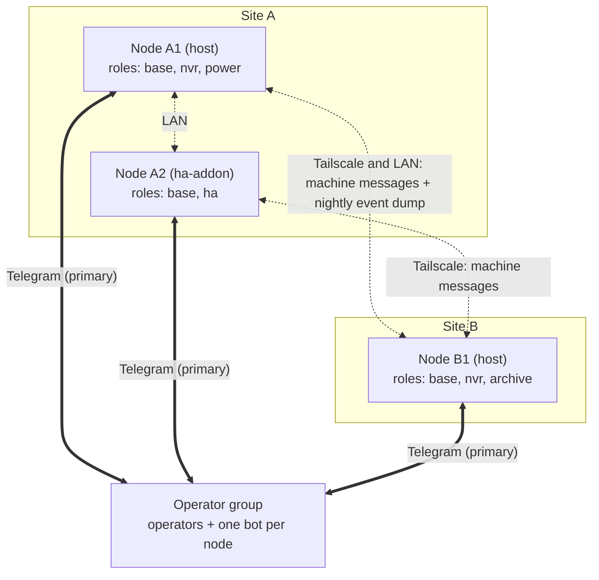

# Edge System Design

Status: draft · Last updated: 2026-11-03

Implemented so far: the Phase 1 configuration layer (`fleet.yaml`, `--config`/`--node`/`--check`/`--write-config`/`--classic`/`--role`, roles mapped onto the existing install variables, the saved fleet file for `--auto`). Not yet: node keys and signed messages, heartbeats, the fleet hash and version check, the bot split into modules, and the `archive`, `agent` and `ha-addon` parts.

## Goals and principles

An edge system is a small fleet of machines, called nodes, at one or more sites. The nodes watch each other, fix known problems safely on their own, and report everything else to their operators through Telegram. Every node runs the same code; what it does is set by its roles in a small YAML file, and nothing about any particular deployment is built into the code.

1. **No main point of failure.** Every node has its own bot and watches the others; any one can fail and the rest report it.
2. **Telegram first, Tailscale second.** Bots always talk to the operators through Telegram, in the group and in private chats. Messages between nodes always travel over Tailscale and the site LAN, which also carry bulk data; bot-to-bot messaging through Telegram is an optional extra path. Nothing else is needed to run; GitHub (releases) and the AI service (incident agent) are optional.
3. **One codebase, roles per node.** The same edge\_server release runs everywhere, packaged for Ubuntu Server hosts or as a Home Assistant add-on.
4. **Configuration, not code.** Names, sites, roles, bots, addresses and thresholds come from one file, `fleet.yaml`; secrets come from the secrets store. Defaults are generic, and the repository ships examples, never a real deployment.
5. **Same command, independent answers.** A command posted in the operator group is answered by every bot whose roles support it, each in its own message.
6. **Power comes first.** At sites with the `power` role, every alert is read against battery state, and a planned low-power shutdown is announced, not alarmed.
7. **Dumb before smart.** Hardware power-on, relays and fixed actions handle known failures in seconds and work without internet. The AI agent handles only what they cannot.
8. **The doctor is never the patient.** A node's problems are investigated and fixed by another node.
9. **Autonomy has a fence.** Automatic fixes are reversible, allowlisted and rate-limited; anything else waits for an operator's authenticator code.
10. **Outside services are optional.** Core monitoring, fixed repairs and safe shutdown run without internet. Release downloads and the AI agent need it and may be unavailable; no incident depends on an AI answer.

## Concepts

| Term | Meaning |
| --- | --- |
| Node | One machine running the edge system, with exactly one Telegram bot |
| Site | A location; nodes at the same site share a LAN and can power-cycle each other through relays |
| Role | A feature set a node runs: `base` (always), `nvr`, `power`, `archive`, `ha`, `agent` |
| Packaging | `host`: Ubuntu Server set up by the deploy script. `ha-addon`: inside a Home Assistant OS add-on |
| Fleet | Every node, described in one file, `fleet.yaml`, identical on all nodes |
| Operator | A person allowed to command the bots, identified by Telegram user id |
| Operator group | One Telegram group holding the operators and every node's bot |



*A typical two-site fleet: 3 nodes, 3 bots, one operator group. Heartbeats and other machine messages travel over Tailscale and the LAN, and also in private bot-to-bot chats when enabled; privileged commands go to one bot in a private chat.*

Any number of nodes and sites works the same way. One node alone works, but nothing can report its own death, so a fleet should have at least two nodes, ideally at two sites.

**Who tells the operator.** Each node judges for itself which nodes look down. To keep to one alert per problem the nodes try to agree: the first healthy node in `alert_order` sends it. When nodes cannot reach each other, as in a split between sites, each side may alert about the other: a duplicate is better than silence. When contact returns the nodes reconcile and send one summary. There is no quorum or election.

| What fails | Who notices | Who tells the operator |
| --- | --- | --- |
| A node | Every other node: no heartbeat, no LAN or Tailscale answer | First healthy node in `alert_order` |
| A site's internet | Nodes at other sites: every bot and Tailscale address at that site goes silent | First healthy node elsewhere; the site's nodes report the outage length when back |
| Tailscale only | Every node: heartbeats still arrive over the LAN or, if enabled, Telegram | One path warning |
| Telegram | Each node: its own Telegram calls fail, Tailscale works | Nobody until it returns, then one summary per bot |

## Configuration: fleet.yaml

One small YAML file, `fleet.yaml`, describes the whole fleet: its sites, its nodes with their roles and settings, and the Telegram group. Every node holds the same file and is told which entry is itself. It contains no secrets, so it can live in a private repository and be copied freely.

```yaml
# fleet.yaml: the whole fleet, identical on every node. No secrets here.
schema_version: 1
fleet:
  name: my-fleet
  telegram:
    group_id: -1000000000000     # the operator group
    operators: [100000001]       # Telegram user ids allowed to command
    bot_to_bot: false            # optional; also copies machine messages through Telegram
  alert_order: [site-b-archive, site-a-nvr, site-a-ha]
  update:
    repo: https://github.com/realsystem/edge_server.git   # forks set their own

sites:
  site-a:
    timezone: UTC
    lan_subnet: 192.168.1.0/24   # optional; detected when absent
    power: {conserve: 40, shed: 25, survive: 15, dark: 10}   # battery %, only where a node has power
    relays:                      # optional; relays with a local HTTP API
      - {name: uplink, url: http://192.168.1.50, powers: router}
      - {name: poe,    url: http://192.168.1.52, powers: poe-switch}
      - {name: ha,     url: http://192.168.1.51, powers: site-a-ha}
  site-b:
    timezone: UTC

nodes:
  site-a-nvr:                    # unique name, shown in every bot reply
    site: site-a
    packaging: host
    roles: [nvr, power]          # base is always on
    options: {mqtt: false, hwaccel: false}
    bot_id: 200000001
    tailscale: site-a-nvr
    lan: 192.168.1.10
    nvr:
      storage: {uuid: "<filesystem uuid>", mount: /mnt/storage}
      archive_target: site-b-archive
      dump_time: "02:00"
    power:                       # device keys go in the secrets store
      victron: {address: "AA:BB:CC:DD:EE:01"}
      renogy: {address: "AA:BB:CC:DD:EE:02"}
  site-a-ha:
    site: site-a
    packaging: ha-addon          # Home Assistant OS on its own machine
    roles: [ha]
    bot_id: 200000002
    tailscale: site-a-ha
    lan: 192.168.1.2
  site-b-archive:
    site: site-b
    packaging: host
    roles: [nvr, archive, ha]    # here Home Assistant runs as a container on the host
    bot_id: 200000003
    tailscale: site-b-archive
    archive:
      arrays: [{uuid: "<filesystem uuid>", mount: /srv/archive}]
      samba: {share: files, user: operator}
      retention_days: {events: 30, configs: 30}
```

- **One file, one node chosen.** `--node <name>` tells a host which entry is itself and is saved for `--auto`. On Home Assistant OS the add-on reads the file from Home Assistant's `share` folder, and its `node` option names the node.
- **Deploy:** `sudo ./deploy-edge-server.sh --config fleet.yaml --node site-a-nvr` on the node, or `./bootstrap.sh --config fleet.yaml --node site-a-nvr <address>` from the operator's computer. `--role` overrides the node's roles for one run.
- **Secrets stay out.** Bot token, TOTP secret and the node's private signing key go into the existing secrets store (`secrets.sh`) on hosts and into password options in the add-on.
- **Optional fleet settings, with defaults.** `fleet.suspect_after` (5 minutes), `fleet.control_port`, a relay's `owner`, and the incident agent's limits (`turns`, `minutes`, `tokens`).
- **Bots are known by numeric id.** Replies are labelled with the node name; a bot's display name is whatever the operator chose in @BotFather and appears nowhere in the code. A node's identity is its name and its signing key, not its bot, so a bot can be replaced (new `bot_id`) without changing who the node is.
- **Validation first.** Every node validates the whole file before changing anything: unique names, known roles and packagings, the settings each node's roles need, `alert_order` covering every node, `archive_target` naming an archive node. Errors name the line. Settings for roles a node does not run are ignored, but an unknown setting is an error, never silently skipped. The file starts with a `schema_version`, and a release refuses a newer one than it understands. Each node's `public_key` (its Ed25519 signing key, not a secret) is added to its entry after the node's first deploy; the shipped examples leave the keys out.
- **The same file everywhere, checked.** Every heartbeat carries the SHA-256 of the node's fleet file and its edge\_server version. If nodes hold different fleet files for more than 10 minutes, one warning goes to the group naming which nodes hold which version of the file, repeated daily until they match. Different software versions show in `/fleet` and get one daily notice while they differ, because add-on nodes may update later than hosts. A node reports its installed version, its running version and the result of its last deploy; a node whose deploy failed counts as different even when the numbers match. Add-on images are pinned by release tag and image digest.
- **Changing the fleet.** Edit the file, copy it to every node, then deploy on hosts (or `/redeploy`) and restart the add-on on Home Assistant OS nodes. Fetching the file from a private repository can come later; the check stays the same.
- **Existing installs keep working.** With no `fleet.yaml` the script behaves as today: one node, role `nvr`, `.telegram` and environment variables as now. `--write-config` writes a one-node `fleet.yaml` from the current settings.
- **Examples, not deployments.** The repository ships `examples/fleet.minimal.yaml` (one node) and `examples/fleet.two-site.yaml` (see Example deployment).

## Roles and packaging

| Role | Includes | Packaging |
| --- | --- | --- |
| `base` (always) | Bot core: group and private chats, command routing by role, auth and TOTP, alerts with confirm and repeat, heartbeats and fleet checks, signing keys, incident store, `/status` `/fleet` `/diag` `/logs` `/mute` `/id`. On hosts also: Tailscale, firewall, Docker, host helpers, SMART, image cleanup, `--auto` redeploy, NUT when a battery or UPS is found | host, ha-addon |
| `nvr` | Frigate, camera discovery, recording storage, camera and recording alerts, `/cams`, `/events`; with `nvr.archive_target` set, the sending side of the nightly event dump | host |
| `power` | Battery and solar plugins (Victron shunt, Renogy Rover today), `/power`, low-battery alerts, power stages | host |
| `archive` | RAID storage, a Samba share, a receive-only target for event dumps and config backups, retention, `/archive` | host |
| `ha` | Home Assistant status, `/ask` to a conversation agent, `/power` from HA sensors, HA restart and host reboot with a code. On an `ha-addon` node it uses the Supervisor; on a host it uses the HA container's API | host, ha-addon |
| `agent` (later) | Claude Code incident agent, restricted `site-ops` account with a dispatcher, repair catalog and executor, approvals | host |

**Packaging**

- **host:** Ubuntu Server 22.04 or newer, set up by `deploy-edge-server.sh`. Supports every role.
- **ha-addon:** for nodes running Home Assistant OS, where the deploy script cannot run. An add-on repository builds an image that installs the edge\_server bot core from a pinned release tag and runs it with `base` and `ha`. edge\_server documents this contract: the add-on reads `fleet.yaml` from Home Assistant's `share` folder, its options name its node and hold the secrets, and it needs `hassio_api: true` with a Supervisor role that allows Core restart and host reboot. There is no `/redeploy` on these nodes; Home Assistant updates the add-on.

MQTT and the Home Assistant container stay plain options on hosts (`INSTALL_MQTT`, `INSTALL_HOMEASSISTANT`); nothing in this design depends on MQTT.

**Where Home Assistant runs.** Either place gives the same `ha` commands and checks: on a host, `ha` in the node's roles installs the Home Assistant container next to the other services (today's `INSTALL_HOMEASSISTANT`); on its own machine with Home Assistant OS, it is an `ha-addon` node with its own bot. A fleet can mix both.

## Telegram: operator group, bots and protocol

One private group holds the operators and every node's bot, and operators can also talk to each bot privately. Telegram carries commands, answers, alerts, reports and, optionally, copies of the bots' machine messages.

**Setup (per fleet)**

- Create one bot per node in @BotFather and turn on Bot-to-Bot Communication Mode for each ([bot-to-bot](https://core.telegram.org/api/bots/bot-to-bot)).
- Add every bot to the operator group as an admin with no rights beyond deleting messages. Admin bots receive every message, so a plain `/status` reaches them all ([bot features](https://core.telegram.org/bots/features)).
- Put each bot's numeric id into `fleet.nodes`, the group id and operator ids into `telegram`, and each bot's token into its node's secrets.

**Bot-to-bot messaging is optional** (`telegram.bot_to_bot`, off by default). What every deployment needs is each bot talking to the operators, in the group and in private chats. Machine messages always go as signed messages between nodes over Tailscale and the LAN; with bot-to-bot on, Telegram carries a copy as well, so a fault on one path shows on the other. Everything else in this design works either way.

**Command routing**

1. A plain command in the group (`/status`) is answered by every bot whose node's roles include it, each in its own message, starting with the node's name.
2. A command addressed to one bot (`/status@<bot>`) is answered only by that bot, with "not supported here" if its roles lack it.
3. A plain command no bot supports gets one "unknown command" from the first healthy node in `alert_order`.
4. Privileged commands (`/reboot`, `/restart`, `/redeploy`, approvals) work only in an operator's private chat with one bot. Each bot has its own TOTP secret, so one code never acts on two nodes.
5. Bots never answer another bot's group message, so they cannot loop.

| Command | Role | Answer |
| --- | --- | --- |
| `/status` | `base` | Node health, one block per role, fleet summary |
| `/fleet` | `base` | Every node, every path, last seen, software version, fleet file hash, each node's view of the others |
| `/diag`, `/logs <service>` | `base` | Diagnostics and container logs (Supervisor logs on `ha-addon` nodes) |
| `/restart <service> <code>`, `/reboot <code>` (private) | `base` | Restart one service, reboot the node |
| `/redeploy <code>` (private) | `base` | Deploy the newest green release (hosts only) |
| `/mute <check> <hours>`, `/id` | `base` | Silence a check, show your user id |
| `/cams`, `/events [hours]` | `nvr` | Latest snapshots, recent events |
| `/power` | `power`, `ha` | Battery, solar and load from that node's sources |
| `/archive` | `archive` | Last dump per source, sizes, free space, RAID state |
| `/ask <question>`, or plain text in a private chat | `ha` | Answer from the conversation agent |
| `/incidents`, `/investigate <text>` | `agent` | Open incidents, start an investigation |

**Machine messages** never go in the group: they travel in private bot-to-bot chats when \`bot\_to\_bot\` is on, and always as signed HTTP between nodes over Tailscale and the LAN. That path is the one the fleet depends on and is tested first; the Telegram copy is an extra path, sent every 5 minutes and on any change instead of every 60 s, to stay well inside Telegram's rate limits. Each is one line of JSON, signed with the sending node's own Ed25519 key. A bot accepts one only from a node listed in `fleet`, correctly signed, under 2 minutes old, with an `id` it has not seen before; seen ids are kept on disk, so a restart does not reopen replays.

| Type | Sent | Content |
| --- | --- | --- |
| `heartbeat` | Every 60 s | Boot id and sequence number, roles, uptime; state of the paths (Telegram, Tailscale, LAN) and of the services (bot, Frigate, storage, Home Assistant); power stage and battery; open incident; view of the others; software version, fleet file hash |
| `alert_claim` | When a node looks down | Which node will alert |
| `outage_notice` | Before a planned low-power shutdown | Expected silence until |
| `dump_sent`, `dump_received` | After each dump | Event count, bytes, checksum of the file list |
| `repair_request` | When an agent needs another node to act | Target, action, reason |

A machine message never runs anything by itself: the receiving node checks it against its own allowlist, rate limits and power stage, and anything beyond a safe fix still waits for an operator's code.

**Message contract.** Every message carries `id`, `from`, `to` (a node or `fleet`), `created`, `expires`, `seq` (counts up per sender and survives restarts), `type`, an optional `ref` naming the incident or request it belongs to, a `body` and `sig`. Messages that matter (`repair_request`, `dump_sent`, `dump_received`, `alert_claim`) are acknowledged and retried until they expire, and a persistent outbound queue holds them while a path is down. Receiving is not doing: a `repair_request` moves through `created`, `delivered`, `accepted`, `running` and `done` or `failed`, and each step is reported back to the sender. Heartbeats carry each node's clock; a difference of more than 30 s is reported as a warning, and freshness is judged by `expires` against the receiver's own clock, so a node with a wrong clock is flagged, not trusted.

**Control port.** Machine messages go to one fixed port per node (`fleet.control_port`, set once for the fleet). The listener binds only to the node's Tailscale and site LAN addresses, never to every interface, and Tailscale ACLs and the host firewall allow it between nodes only. Tailscale encrypts the traffic; on the LAN messages are signed but not secret, which is why they never carry tokens. Identity comes from the signature, so no certificates are needed. If one path is down, the sender tries the other.

**Approval flow**

1. The agent writes an `action_request`: an id, action and parameters, target, reason, expected effect, how to undo it, expiry (5 minutes).
2. The bot of the node that would act sends it to the operators in private chats.
3. An operator replies `/approve <request id> <code>` with that bot's authenticator code. The bot checks the operator's id, that the chat is private, that the request is still open, unexpired and unchanged since it was sent, that it names this node, and that the code's time step was never used; three wrong codes lock the operator out.
4. The bot runs exactly that action and nothing else, logs the code check and the approval as separate events, and reports in the group; the agent re-checks and closes or escalates the incident.

**Privacy.** Groups and bot chats are not end-to-end encrypted, so messages never carry passwords or tokens, and `/diag` and `/logs` remove secrets.

## Monitoring

Most checks already exist in the edge\_server bot; new are the heartbeats, the uplink, Tailscale and Telegram checks, and the RAID and dump checks. Nothing here needs the AI.

**Heartbeats.** Every 60 s each bot sends a signed heartbeat to every other bot. Every 5 minutes each node also checks the others over Tailscale, and nodes at the same site over the LAN. A late heartbeat triggers these checks at once, so the verdict never waits for the next scheduled check. A node is down after 5 minutes with no heartbeat and no Tailscale or LAN answer; one silent path alone is a path warning. When every node of a site goes silent at once, the alert says "site unreachable" (uplink or power; from outside the cause cannot be known) with each node's last battery level and stage, instead of one node-down alert per node. Meanwhile the site's nodes keep checking each other over the LAN and queue their reports. When the site returns, they send the outage length and their uptimes: uptimes that span the outage mean the link failed, uptimes that restarted mean power was lost. A heartbeat shows that the bot is alive, not that the node is healthy, so liveness, paths, services and power are reported and judged separately. A new boot id tells a restart from a stale message, and the sequence number exposes replays and gaps. The 5 minutes is the default of `fleet.suspect_after`, and a problem is closed as recovered only after its check passes twice in a row.

| Check | Runs on | Every | Alert when | Exists today |
| --- | --- | --- | --- | --- |
| Heartbeats | Every node | 1 min | 5 min silent and no other path answers (not during an announced outage) | New |
| Tailscale and LAN reachability | Every node | 5 min | Fails while heartbeats arrive: path warning | New |
| Own Telegram reachability | Every node | 1 min | Calls failing: switch to fallback checks, report later | New |
| Internet uplink | One node per site | 1 min | 3 failures in a row | New |
| Frigate and each camera | `nvr` | 1 min | 3 checks in a row | Yes |
| Disk free, SMART, CPU temperature | Hosts | 5 min, 6 h, 1 min | Below 15% free; failing or 80% worn; 85 C | Yes |
| RAID state | `archive` | 5 min | Degraded, rebuilding or failed | New |
| Event dump | Sender and `archive` | Daily | Not received and verified 4 h after `dump_time` | New |
| Home Assistant Core | `ha` | 1 min | 3 failures in a row | Partly (ping and HTTP) |
| Battery, solar, load | `power`, `ha` | 1 min | Power stage thresholds | Readings yes, alerts new |
| Person detected, camera tamper | `nvr` | Event | Immediately, with snapshot | New |
| Fleet file and software version | Every node, from heartbeats | 1 min | Fleet files differ for 10 min (then daily); software versions differ (daily notice) | New |

Thresholds above are defaults; each can be overridden in `fleet.yaml`.

## Auto-repair

Repairs climb four layers; each acts only when the one below has failed or does not cover the problem.

1. **L0, hardware.** BIOS power-on after AC loss on hosts. Relays with a local HTTP API (listed in `relays`) for the uplink, PoE switches and nodes, so another node at the site can power-cycle them without internet.
2. **L1, fixed actions.** Restart a service, re-up Tailscale, power-cycle a relay, prune old recordings. On hosts through edge\_server's host helpers; on `ha-addon` nodes through the Supervisor API.
3. **L2, incident agent.** On an `agent` node, investigating another node, started only when L1 fails twice or a problem has no fix. For an `ha-addon` node it sends that node's bot a `repair_request`.
4. **L3, operator.** An authenticator code for anything gated, or a visit for hardware.

| Failure | Detected by | Automatic action | The operator hears |
| --- | --- | --- | --- |
| Site internet down | Uplink check at the site; silence seen from other sites | A node at the site power-cycles the uplink relay after 10 min, then every 60 min, at most 6 times a day | Down from another site; back, with outage length, from the site |
| Tailscale broken, internet up | Tailscale checks fail, heartbeats fine | Restart Tailscale on that node; agent if it persists | One path warning |
| Telegram unreachable | Each node's own calls | Nothing to fix; checks continue over Tailscale and LAN, reports queued | One summary per bot when it returns |
| Home Assistant unresponsive | The `ha` node's bot; same-site nodes | Restart Core; if that bot is silent too, a same-site node power-cycles its relay after 5 min | The first healthy node in `alert_order` |
| Node hung | Other nodes | A same-site node power-cycles its relay if one is listed; otherwise an agent on another node investigates | The first healthy node in `alert_order` |
| Camera offline | `nvr` | Restart Frigate; if several cameras on one PoE switch are down, power-cycle that switch's relay (cycling a single port needs a managed switch) | That node's bot, with camera name |
| RAID degraded or disk failing | `archive`, SMART | None; never automatic | That node's bot, immediately |
| Disk filling | `nvr` | Delete oldest recordings down to the retention policy | Daily summary only |
| Battery low | `power`, `ha` | Power stages, `outage_notice` to nodes at other sites | At each stage |
| Person detected, camera tampered | `nvr` | None; never automatic | That node's bot at once, with snapshot |

A node with its own battery, such as a laptop, rides through power cuts but cannot be rebooted by cutting its power; where that matters, prefer hardware without a battery behind a relay.

**Incidents.** Every problem becomes an incident with a persistent id (for example `inc-20261103-001`), kept in a local SQLite file on the node that detected it and copied to the `archive` node when possible. An incident records its target, type and status (`open`, `investigating`, `fixing`, `waiting_approval`, `resolved`), what was observed, every attempt with its result, and any proposed action. A restart or a Telegram outage does not lose it.

**Pipeline.** Detect, then a known fixed action, then (only if needed) the agent, then the policy check, then the executor, then verification by the same monitoring that raised the incident. Only the policy check and the executor have authority. The agent investigates and proposes; it never executes. The policy check validates target, action and parameters against the lists, the rate limits, the power stage and, for T2, the approval; anything it rejects becomes a report to the operators.

**Relays.** Each relay has one owner node at its site (the `owner` option; by default the first node of the site that can reach it). Other nodes ask the owner with a `repair_request`, so two nodes never drive the same relay. The owner switches off, waits, switches on, reads the state back, and holds a lock that expires after a maximum duration. If the owner is down for 5 minutes, the next node at the site takes over.

## Power-aware operation

For sites running on their own power. The uplink and the nodes that see and fix everything stay on longest; the battery levels come from the site's `power` settings in `fleet.yaml`.

| Stage | Battery | Actions | Restore when |
| --- | --- | --- | --- |
| Normal | Above `conserve` | Everything on | n/a |
| Conserve | `conserve` to `shed` | Pause the incident agent except for power issues; recording motion-only; event dump sends snapshots only | 5 points above `conserve` |
| Shed | `shed` to `survive` | Turn off nonessential loads; keep the cameras marked essential; skip the event dump | 5 points above `shed` |
| Survive | `survive` to `dark` | Send `outage_notice` to other sites; hosts without a battery shut down cleanly; only uplink and the `ha` node stay on | 10 points above `survive`, and charging |
| Dark | Below `dark` | Remaining nodes shut down cleanly; the battery's low-voltage disconnect takes the rest | Power returns; everything boots by itself |

- **Planned outage.** After an `outage_notice`, other sites report a power outage instead of a site failure, and alarm only if the site has not returned by the time in the notice.
- **Clean recovery.** Every node must start by itself when power returns: BIOS power-on after AC loss, services enabled at boot. Test it before relying on it.
- **Storage.** Sudden power loss corrupts memory cards; boot `ha-addon` and other small nodes from SSD where possible. State the bots keep (queues, counters, seen ids, incidents) is small and written atomically, so a power cut loses at most the last update, and logs are capped. A read-only root filesystem is not required: Home Assistant OS manages its own storage, and `nvr` hosts write recordings anyway.
- **Context in every alert.** Each alert from a `power` site carries battery level and solar input, so "camera offline at 12% battery" reads as expected.
- **Inputs.** Stages use the battery level, its voltage and whether it is charging or discharging; voltage is a cross-check when the level looks wrong. A reading older than 5 minutes counts as unknown, never as healthy: the stage holds, no stage is lifted, and the operators get a "power data stale" alert.
- **Transitions.** Going down may skip stages; going up moves one stage at a time, and a stage lasts at least 10 minutes before the next lift. A level that jumps by more than 20 points at once is held until a second reading confirms it.
- **Essential loads.** The uplink and one node able to coordinate recovery (the site's `ha` node, else its `power` node) stay on until Dark, and every shutdown is announced first.

## Archive role

A node with `archive` keeps the fleet's long-term copies: event dumps from `nvr` nodes, config backups, and a simple file share. It can replace a dedicated NAS operating system, so one codebase manages the machine.

| Part | Does |
| --- | --- |
| Disks | mdadm software RAID, mounted by UUID from `archive.arrays`; alerts when an array is degraded, rebuilding or failed; SMART from `base`. A hardware RAID controller appears as one disk, plus an optional health check for its vendor tool |
| Samba | One share, one user, LAN only, with macOS compatibility settings so Finder copies leave no stray `._` files |
| Event dump | At `nvr.dump_time` each sending node exports the last 24 h of Frigate events (clips and snapshots) and sends them with rsync over Tailscale to a receive-only account; the archive verifies them and files them by source and date. Senders can add, never delete or overwrite: the account has no shell, a forced command or restricted rsync module accepts only new files into unique dated paths, and the archive verifies content before filing. Config backups use a separate account and path, since their retention differs |
| Config backups | Nightly from every host: `fleet.yaml`, `deploy.env`, Frigate config, encrypted secrets; Home Assistant backups from `ha` nodes |
| Retention | `archive.retention_days` per kind; only the archive node prunes. Every backup carries a manifest with node, time, software version and fleet file hash, so a restore knows the state it came from |
| Reports | Sender and archive each post one line in the group ("sent 42 events, 1.3 GB", "received and verified"); `/archive` shows the state |

**Replacing a NAS operating system**

1. Record the disks, arrays and filesystem UUIDs (`mdadm --detail --scan`, `blkid`) and the shares in use.
2. Copy anything irreplaceable to a separate drive first.
3. Install Ubuntu Server on the system disk only.
4. Deploy with `archive` in the roles: arrays are assembled and mounted read-only first.
5. Check the data, then switch to read-write and turn on Samba.

**RAID is not a backup.** One archive node is one place to lose data to a theft, a fire or a corrupted filesystem. Keep a second independent copy of what matters: fleet configuration (on every node and in the archive), an encrypted offline copy of the secrets, Home Assistant backups, and important recordings (on an external disk plugged in now and then, or a second archive node). The design does not need another always-on server; `/archive` reports when the second copy was last made.

## Safety rules and security

Automatic fixes must be reversible, listed in advance and limited in how often they run; everything else waits for an operator's code.

| Tier | Examples | Who can trigger |
| --- | --- | --- |
| T0 read-only | Status, logs, snapshots, fleet view | Operators, any time |
| T1 safe fix | Restart a service, re-up Tailscale, power-cycle a relay, prune recordings | Scripts and the agent, within rate limits |
| T2 gated | Reboot a node, change Home Assistant config, update packages, delete anything except recordings | Agent proposes; runs after an operator's code |
| T3 never remote | Network or firewall changes, Tailscale logout or ACLs, disk formatting, battery or inverter settings | On site only |

**Rules every automatic fix follows**

- **Never cut your own access.** Before an action that could break a path, confirm another path works.
- **Rate limits.** At most 3 automatic actions per target per hour and 10 per day per node (configurable).
- **Circuit breaker.** The same problem twice in 24 hours stops automatic fixing for it and asks the operators.
- **Verify, then close.** After every fix the check runs again; a fix that did not help is reported, not repeated.
- **Log everything.** Each action is recorded with time, reason, before and after state, and copied to the `archive` node.
- **Power gate.** No agent and no updates below Conserve, except power-related actions.

**Incident agent**

- Installed by the `agent` role; runs headless (`claude -p`) in a dedicated folder, started only when L1 fails on another node; never on a timer, never on its own node.
- Uses `dontAsk` permission mode with an explicit allow list, so a step outside the list is denied and becomes a report. Never `--dangerously-skip-permissions`.
- Reads a runbook generated from `fleet.yaml`: the fleet, roles, tiers and these rules.
- Never gets a shell. It investigates through read-only diagnostics from a fixed list (`service_status`, `journal_tail`, `disk_health`, `network_routes`) and proposes repairs from a fixed catalog (`restart_service`, `restart_tailscale`, `power_cycle_relay`), each with parameters. The policy check and a separate executor validate and run them: on other hosts through a restricted `site-ops` account whose SSH key can only run that dispatcher (`sudo` is limited to the host helpers behind it); on `ha-addon` nodes through a signed `repair_request` to that node's bot.
- Each run has three limits, a turn limit (default 20), a wall-clock timeout (default 10 minutes) and a token ceiling, all set in the agent section of fleet.yaml. Reaching any of them stops the run, sends what it found so far to the operators (L3) and counts toward the circuit breaker; a run that loops is cut off and never restarted by itself.

**Security**

- Outside services are Telegram and Tailscale, plus GitHub (release downloads) and the AI service (incident agent); the last two are optional, so core monitoring, fixed repairs and safe shutdown work without them. No inbound ports are open to the internet; bots poll Telegram outbound.
- Bots obey only listed operator ids and listed bot ids; machine messages must be signed, fresh and unique. Each node signs with its own Ed25519 key, generated on the node and never leaving it; the public keys sit in `fleet.yaml`, so a stolen node is revoked by removing its entry and redeploying the others.
- Each bot has its own token and TOTP secret, stored root-only on hosts and as password options in the add-on. Add-on options are visible to the Home Assistant Supervisor and can end up in Home Assistant backups, so an `ha-addon` node's token and key are less protected than a host's: its backups are encrypted and the policy gives it the fewest permissions.
- Tailscale ACLs: operators reach everything; nodes reach each other only on SSH, Frigate, the Home Assistant port, the archive receive account and the control port.
- The archive receive account can only add files: no shell, no delete, no overwrite.
- SSH by key only, password login off, on every host.
- Code arrives only as green-CI release tags: `/redeploy` on hosts, a pinned tag in the add-on image. Protect `v*` tags.
- Cameras on their own network segment with no internet, reachable only from their `nvr` node. Samba on the LAN only.

## Changes to the existing code

The goal is that someone who clones edge\_server can build their own fleet from `fleet.yaml` alone, with nothing tied to one deployment.

**edge\_server**

- Read and validate `fleet.yaml` (`--config`, `--node`, `--write-config`) add a `--check` that validates a file without deploying it, and add the fleet hash and version check; the script installs `python3-yaml` if it is missing.
- `--role` and `node.roles` set the defaults of the existing `INSTALL_*`, `VICTRON_INSTALL` and `RENOGY_INSTALL` variables; an explicit variable still wins. Roles are saved for `--auto`. No config means today's behavior.
- Dropping a role removes its containers and services but keeps their data, as the script already does for Home Assistant and MQTT.
- Split `telegram-bot/bot.py` (about 1,900 lines) into an installable package: a core plus one module per role, versioned with the release tags.
- Add the control plane: per-node Ed25519 keys and signature checks, the message contract with acknowledgments and a persistent queue, the incident store (SQLite), and the policy check and executor between the agent and the host helpers.
- Remove deployment-specific defaults: `HA_HOST=10.0.0.2` (comes from `fleet.yaml` now), the fixed `TIMEZONE` default (from the site's timezone, else the system's), and README wording about "the laptop" and "the Raspberry Pi". `REDEPLOY_REPO` keeps the upstream default and becomes settable in `fleet.yaml` for forks.
- Replace the README's advice to use an outside dead-man's switch with the fleet heartbeats.
- Add `examples/fleet.minimal.yaml`, `examples/fleet.two-site.yaml`, a JSON Schema for the file (`examples/fleet.schema.json`) that CI checks the examples against, and a document describing the add-on contract.

**Home Assistant add-on (example: farm\_agent)**

- The Dockerfile installs the edge\_server bot core from a pinned release tag; the add-on runs it with `base` and `ha` next to its own agent.
- Make the agent's entity allowlist an option; today it is fixed to `sensor.eco_worthy_*`, `sensor.smartshunt_*` and `sun.sun`. Make the "remote farm" prompt wording an option too.
- Fix the tool-call bug (results must be `role: "tool"` messages with their `tool_call_id`), send the system prompt, check the `127.0.0.1` bind and the add-on hostname, and make CI fail when tests fail.

## Deployment

The deploy script keeps working exactly as it does today and gains a fleet mode. Names exist only in `fleet.yaml`: nothing an operator names becomes a path, container or service name, so the same code serves every fleet. A deploy is all or nothing: the script validates the whole file, resolves every setting, prints what would change (`--check` stops here), applies the changes, verifies the services, and only then marks the new file as active. The previous known-good file stays for rollback, and a failed deploy restores it, so a node never runs half the old settings and half the new.

| Mode | Started with | Behavior |
| --- | --- | --- |
| Classic (default) | `sudo ./deploy-edge-server.sh`, and `--auto` or `/redeploy` on an install without a fleet file | Unchanged: environment variables, `.telegram`, `.cam`, prompts and `deploy.env`, as today |
| Fleet | `sudo ./deploy-edge-server.sh --config fleet.yaml --node <name>` | The file is checked first (the same check as `--check`), and an invalid file stops the deploy with nothing changed. Settings come from the node's entry and its site; the last good file and node name are saved (a rejected new file never replaces it, and the heartbeat reports the rejection), so `--auto` and `/redeploy` keep using them |

**Where a setting comes from in fleet mode**, first match wins:

1. Command-line flags (`--node`, `--role`).
2. Environment variables, for one-off overrides, as today.
3. The node's entry and its site in `fleet.yaml`.
4. `deploy.env` from the last run, for settings the fleet file does not cover, such as the Frigate image.
5. Built-in defaults.

**How `fleet.yaml` maps onto today's settings**

| fleet.yaml | Today's setting |
| --- | --- |
| `nodes.<name>.roles` | `INSTALL_HOMEASSISTANT` (`ha`), `VICTRON_INSTALL` and `RENOGY_INSTALL` (`power`), Frigate and camera discovery (`nvr`) |
| `nodes.<name>.options` | `INSTALL_MQTT`, `ENABLE_HWACCEL` |
| `nodes.<name>.nvr.storage` | `EXTERNAL_DRIVE_UUID`, `EDGE_STORAGE_DIR` |
| `nodes.<name>.power.victron`, `.renogy` | `VICTRON_ADDRESS`, `RENOGY_ADDRESS` |
| `sites.<site>.timezone` | `TIMEZONE` |
| `sites.<site>.lan_subnet` | `LOCAL_SUBNET`; still detected when absent |
| `fleet.telegram.operators` | `TELEGRAM_ALLOWED_IDS` |
| The `ha` node at the same site | `HA_HOST`, `HA_PORT`; no Home Assistant check when there is none |
| `fleet.update.repo` | `REDEPLOY_REPO` |

Secrets keep their current homes: `TELEGRAM_BOT_TOKEN` and `REBOOT_TOTP_SECRET` in `.telegram`, `TAILSCALE_AUTH_KEY`, `MQTT_PASS` and `VICTRON_KEY` in the secrets store, plus each node's new private signing key.

**What names change, and what they never change**

- Node and site names appear in bot replies, alerts, heartbeats, log lines and archive folders (`<mount>/<node>/<date>`).
- They never become hostnames, container names, systemd units or install paths: `/opt/edge-server`, the `frigate` container and the `edge-*` units stay as they are. Renaming a node is an edit to the file and a redeploy.
- Names must be lowercase letters, digits and hyphens, so they are safe everywhere they appear.

**Moving an existing install to fleet mode**

1. `sudo ./deploy-edge-server.sh --write-config fleet.yaml --node <name>` writes a one-node file from the current `deploy.env` and `.telegram`, without secrets.
2. Edit the names and add the other nodes.
3. Deploy with `--config fleet.yaml --node <name>`. Nothing should change except the names in bot replies; this is the first failure drill.
4. `--classic` returns to classic mode and forgets the saved fleet file.

## Build plan and drills

Phase 0 tests two things before any code depends on them: that signed heartbeats work between all nodes over Tailscale and the LAN, which the fleet needs, and whether bots can talk to each other through Telegram, which is optional. The Telegram docs describe bot-to-bot messaging at the low-level API, and how the Bot API exposes it needs confirming.

```mermaid
flowchart TB
  P0["Phase 0: Prove the control plane<br/>Signed node-to-node messages with acks over Tailscale and LAN, partition test; optional bot-to-bot test"]
  P1["Phase 1: Config and identity in edge_server<br/>fleet.yaml with schema_version, --node and --check, node keys, transactional deploy, hash and version check, bot split into core + role modules"]
  P2["Phase 2: Monitoring and incidents<br/>Heartbeats, path checks, node and site failure detection, incident store, alert agreement and duplicates, Telegram-outage handling"]
  P3["Phase 3: Fixed repairs and power<br/>Service and Tailscale fixes, relay owners, rate limits, circuit breaker, verification, power stages"]
  P4["Phase 4: Archive role and recovery<br/>mdadm by UUID, RAID alerts, Samba, append-only receiver, event dump, retention, second copy"]
  P5["Phase 5: Home Assistant add-on packaging<br/>Add-on contract, example add-on pins the bot core, ha role"]
  P6["Phase 6: Incident agent<br/>agent role, diagnostics and repair catalog, executor, runbook from fleet.yaml, approvals"]
  P0 -->|"Gate: signed messages and acks work between all nodes; a forged or replayed message is rejected"| P1
  P1 -->|"Gate: existing install upgrades unchanged; a new host joins with only fleet.yaml; a bad file changes nothing"| P2
  P2 -->|"Gate: node-failure and partition drills pass"| P3
  P3 -->|"Gate: repair and power drills pass"| P4
  P4 -->|"Gate: arrays mounted, share usable, a test dump received and verified, second copy made"| P5
  P5 -->|"Gate: /power in the group gets independent answers from two nodes"| P6
```



**Failure drills** (run once after building, then one a month)

- [ ] Upgrade an existing install with no `fleet.yaml`: nothing changes
- [ ] Post `/status` in the group: one answer per node; `/status@<bot>`: one answer
- [ ] Unplug a site's router: one alert from another site, the uplink relay cycles, the site reports the outage length
- [ ] Stop Tailscale on one node: one path warning, no node-down alert
- [ ] Block Telegram on one node's firewall: checks continue over Tailscale, one summary when unblocked
- [ ] Cut a whole site's uplink: one "site unreachable" alert, and on return the outage length and whether the link or the power failed
- [ ] Give a node a broken fleet.yaml: the deploy stops, the old file stays, the heartbeat reports it
- [ ] Make the incident agent loop: it is cut off at its limit and the operators get what it found
- [ ] Block Tailscale between two sites: both sides may alert, and one summary follows when contact returns
- [ ] Start two relay cycles at once: only the relay's owner acts
- [ ] Replay an old signed message after a restart: rejected
- [ ] Cut a battery reading for 10 minutes: a "power data stale" alert, no stage lifted
- [ ] Stop Home Assistant on an `ha` node: restarted within 5 minutes
- [ ] Stop one bot: the first healthy node in `alert_order` reports it while LAN and Tailscale still answer
- [ ] Unplug a camera: the right bot names it
- [ ] Pull a disk from a test array: RAID degraded alert, nothing automatic
- [ ] Skip a night's dump: alert 4 hours after `dump_time`
- [ ] Send a forged or replayed machine message: rejected and logged
- [ ] Pull power from a whole site: every node boots by itself and reports in
- [ ] Restore a Home Assistant backup and a config backup from the archive

## Example deployment: a two-site off-grid fleet

A fleet with a remote off-grid site and a home site, shipped as `examples/fleet.two-site.yaml`. It is modelled on a real deployment but uses generic names; operators choose their own names when they write their fleet file. A one-node starting point is `examples/fleet.minimal.yaml`.

| Node | Site | Hardware | Packaging | Roles |
| --- | --- | --- | --- | --- |
| `remote-nvr` | remote (off-grid) | Ubuntu laptop | host | `nvr`, `power`, `agent` |
| `remote-ha` | remote (off-grid) | Raspberry Pi 5, Home Assistant OS | ha-addon | `ha` |
| `home-server` | home | Desktop with RAID disks, replacing a NAS operating system | host | `nvr`, `archive`, `agent` |
| `home-ha` | home | Raspberry Pi 3, Home Assistant OS | ha-addon | `ha` |

```yaml
# examples/fleet.two-site.yaml: a remote off-grid site and a home site.
# Names, ids and addresses are placeholders; choose your own.
schema_version: 1
fleet:
  name: two-site
  telegram:
    group_id: -1000000000000
    operators: [100000001]
    bot_to_bot: false
  alert_order: [home-server, remote-nvr, remote-ha, home-ha]

sites:
  remote:                      # off-grid: solar, battery, satellite uplink
    timezone: UTC
    power: {conserve: 40, shed: 25, survive: 15, dark: 10}
    relays:
      - {name: uplink, url: http://192.168.10.50, powers: router}
      - {name: poe,    url: http://192.168.10.52, powers: poe-switch}
      - {name: ha,     url: http://192.168.10.51, powers: remote-ha}
  home:
    timezone: UTC

nodes:
  remote-nvr:                  # laptop with its own battery
    site: remote
    packaging: host
    roles: [nvr, power, agent]
    bot_id: 200000001
    tailscale: remote-nvr
    lan: 192.168.10.10
    nvr:
      storage: {uuid: "<filesystem uuid>", mount: /mnt/storage}
      archive_target: home-server
      dump_time: "02:00"
    power:
      victron: {address: "AA:BB:CC:DD:EE:01"}
      renogy: {address: "AA:BB:CC:DD:EE:02"}
  remote-ha:                   # Raspberry Pi 5, Home Assistant OS
    site: remote
    packaging: ha-addon
    roles: [ha]
    bot_id: 200000002
    tailscale: remote-ha
    lan: 192.168.10.2
  home-server:                 # desktop on a UPS, replacing a NAS operating system
    site: home
    packaging: host
    roles: [nvr, archive, agent]
    bot_id: 200000003
    tailscale: home-server
    nvr:
      storage: {uuid: "<filesystem uuid>", mount: /srv/archive/cameras}
    archive:
      arrays: [{uuid: "<filesystem uuid>", mount: /srv/archive}]
      samba: {share: files, user: operator}
      retention_days: {events: 14, configs: 30}
  home-ha:                     # Raspberry Pi 3, Home Assistant OS (64-bit)
    site: home
    packaging: ha-addon
    roles: [ha]
    bot_id: 200000004
    tailscale: home-ha
```

Deploy on each host with `--config fleet.yaml --node remote-nvr` or `--node home-server`; on each Home Assistant OS machine, copy the file to Home Assistant's `share` folder and set the add-on's `node` option.

- **Remote site:** satellite uplink, solar and battery; cameras on PoE through a simple unmanaged switch, so they can only be power-cycled together, through the switch's relay.
- **`remote-nvr`** is a laptop with its own battery, so a relay cannot reboot it; it runs the NUT power monitor.
- **`remote-ha` and `home-ha`** are set up the same way: Home Assistant OS with an add-on running the bot core, each with its own bot. Add-ons built only for 64-bit (aarch64, amd64) need the 64-bit Home Assistant OS image on a Pi 3. Booting from USB SSDs instead of memory cards is recommended.
- **`home-server`** replaces a NAS operating system: mdadm RAID, one Samba share for a Mac, its own cameras on a simple PoE switch, and the nightly event dump from `remote-nvr`, kept for 14 days. It is on a UPS, so `base` installs NUT for clean shutdowns.

## Open questions

- [ ] Phase 0, to test later: does bot-to-bot messaging work through the Bot API? It is optional either way.
- [ ] Later, not blocking: staged rollout (one node first, then the rest)
- [ ] Later: idempotency keys for repairs and alerts, and message priorities in the outbound queue
- [ ] Later: protect archive free space by refusing dumps below a floor
- [ ] Later: log rotation with quotas, and structured logs and counters kept on the node
- [ ] Later: per-disk SMART thresholds, and documented BIOS power-recovery settings
- [ ] Later: UTC internally, local time only for schedules and display

## Sources

- [realsystem/edge\_server](https://github.com/realsystem/edge_server) (release v1.2)
- [realsystem/farm\_agent](https://github.com/realsystem/farm_agent) (add-on 0.4.0)
- [Telegram: bot-to-bot communication](https://core.telegram.org/api/bots/bot-to-bot)
- [Telegram: bot features (privacy mode, groups)](https://core.telegram.org/bots/features)
